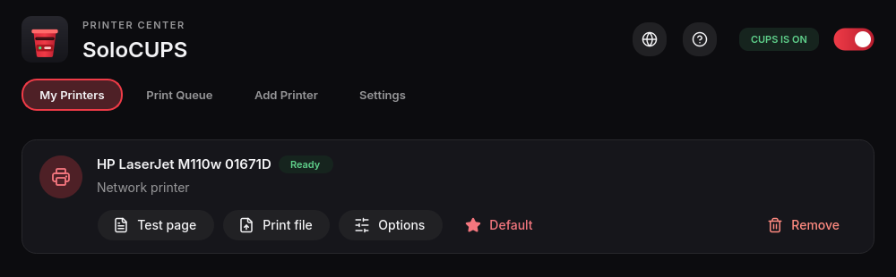

# SoloCUPS

A simple, zero-headache printer manager for Linux. SoloCUPS is a friendly front end for CUPS: see your printers, add one, print a test page, manage the queue, and fix common problems without touching a terminal.



## Features

- **My Printers**: status at a glance, test page, print a file, options, set default, remove
- **Print Queue**: see and cancel jobs
- **Add Printer**: finds Wi-Fi/network and USB printers automatically, or type an address like `ipp://192.168.1.50/ipp/print`
- **CUPS on/off switch** and a shortcut to the CUPS web interface
- Dark theme that follows your desktop's accent colour

It uses CUPS's own command-line tools, so there's nothing extra to set up beyond PyQt6. Admin actions ask for your password through polkit.

## Install

**Arch / CachyOS** (AUR, once published) or build from this repo:

```bash
git clone https://github.com/Obscuratea/SoloCUPS.git
cd SoloCUPS
makepkg -si
```

**Any distro** (installs just for your user, no sudo needed):

```bash
git clone https://github.com/Obscuratea/SoloCUPS.git
cd SoloCUPS
./install.sh
```

The script checks for dependencies and tells you the exact command for your distro if anything is missing. Then launch **SoloCUPS** from your app menu, or run `solocups`.

To remove it: `./uninstall.sh`

### Requirements

- Python 3 and PyQt6 (with QtSvg)
- CUPS, running: `sudo systemctl enable --now cups`
- polkit (for admin prompts)
- Optional, for finding Wi-Fi and driverless USB printers: `avahi`, `nss-mdns`, `ipp-usb`, then `sudo systemctl enable --now avahi-daemon`

## Troubleshooting

- **"CUPS is off"**: flip the switch in the top right, or run `sudo systemctl enable --now cups`.
- **Wi-Fi printer not listed**: install the optional packages above, or add it by address.

## License

MIT. See [LICENSE](LICENSE).
